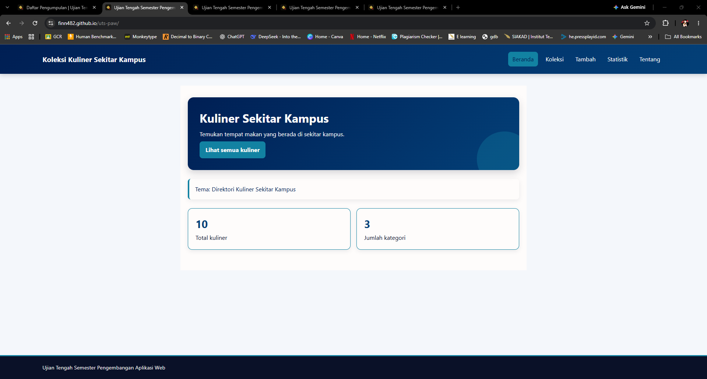

# Direktori Kuliner Sekitar Kampus

Nama: ALFINO PUTRA RUSLIM  
NIM: 124140127  
Kelas: RA  
Tema: Direktori Kuliner Sekitar Kampus  
Deployment: https://finn482.github.io/uts-paw/

## Deskripsi Aplikasi

Direktori Kuliner Sekitar Kampus adalah aplikasi web yang digunakan untuk menampilkan informasi tempat makan di sekitar kampus. Aplikasi ini membantu pengguna melihat daftar kuliner berdasarkan judul dan kategori. Pengguna juga dapat melihat detail tempat makan, menambahkan data kuliner baru, menghapus data, dan melihat jumlah kuliner berdasarkan kategori.

Data kuliner memiliki beberapa informasi, yaitu:

- Judul kuliner
- Kategori
- Alamat
- Harga rata-rata
- Jam buka

## Fitur

- Menampilkan halaman beranda aplikasi.
- Menampilkan jumlah seluruh kuliner dan jumlah kategori.
- Menampilkan daftar kuliner dari file JSON.
- Mencari kuliner berdasarkan judul.
- Menyaring kuliner berdasarkan kategori.
- Menampilkan detail setiap kuliner.
- Menampilkan alamat tempat makan.
- Menampilkan harga rata-rata.
- Menampilkan jam buka.
- Menambahkan data kuliner baru.
- Menyimpan data tambahan ke localStorage.
- Menghapus data kuliner.
- Menampilkan statistik jumlah kuliner berdasarkan kategori.
- Menampilkan informasi mahasiswa pada halaman Tentang.
- Menampilkan halaman 404 untuk rute yang tidak ditemukan.
- Memiliki tampilan responsif untuk perangkat dengan ukuran layar berbeda.

## Menjalankan secara lokal

cd app
npm install
npm run dev

## Konsep React yang dipakai

Beberapa konsep React yang digunakan dalam aplikasi ini adalah:

- Komponen fungsional untuk membangun tampilan aplikasi.
- Props untuk mengirim data ke komponen seperti KartuItem.
- useState untuk mengelola data form, pencarian, dan state aplikasi.
- useEffect untuk mengambil data awal dari file JSON.
- Custom hook useKoleksi untuk mengakses data koleksi.
- Custom hook useLocalStorage untuk menyimpan data pada localStorage.
- Context API untuk membagikan state koleksi ke beberapa halaman.
- useContext untuk mengambil data dari Context.
- React Router untuk mengatur navigasi antarhalaman.
- useParams untuk mengambil ID dari URL.
- useNavigate untuk berpindah halaman melalui program.
- map untuk menampilkan daftar kuliner.
- filter untuk melakukan pencarian dan penyaringan kategori.
- reduce untuk menghitung statistik kategori.
- Form terkontrol untuk halaman tambah kuliner.
- Conditional rendering untuk menampilkan pesan loading, error,
- dan data yang tidak ditemukan.
- fetch dan async/await untuk mengambil data awal dari JSON.
- Vitest dan React Testing Library untuk membuat pengujian aplikas
